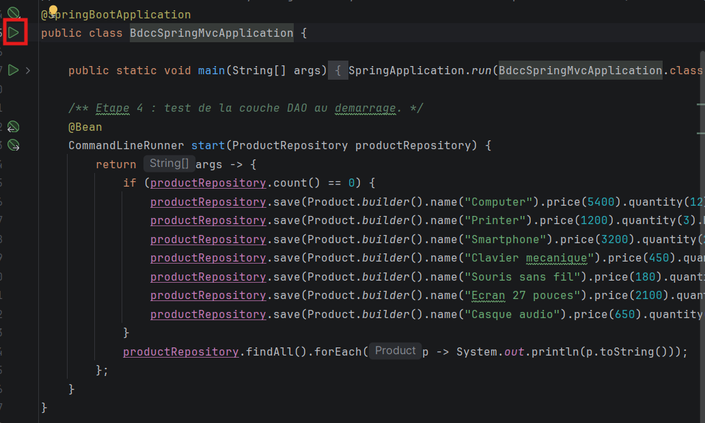
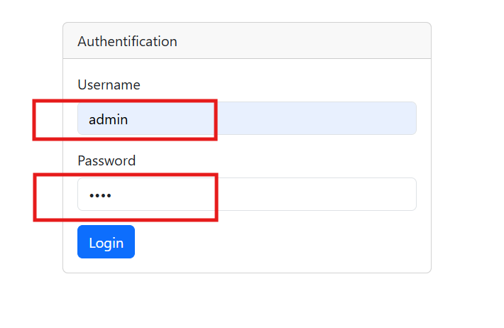
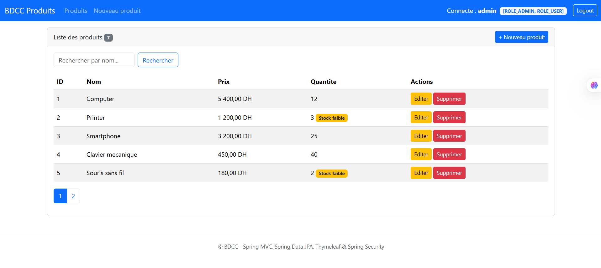
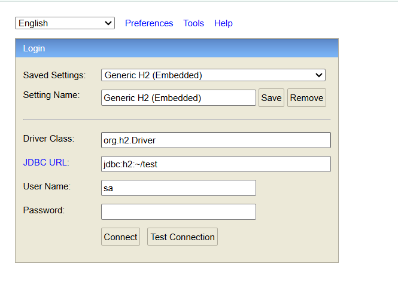
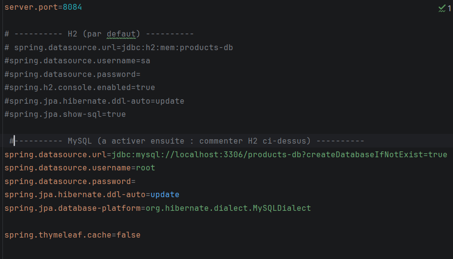
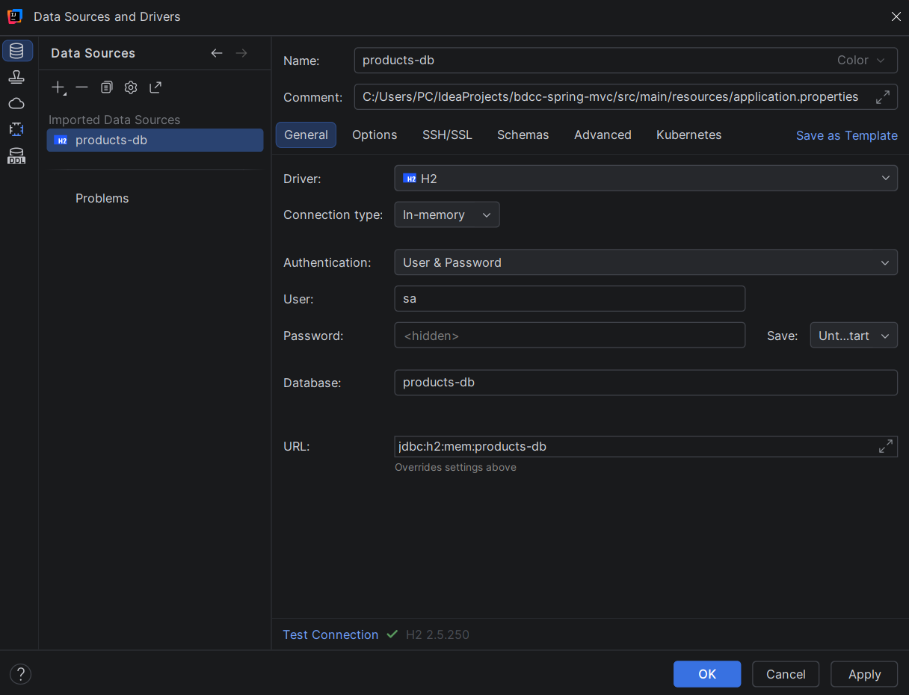
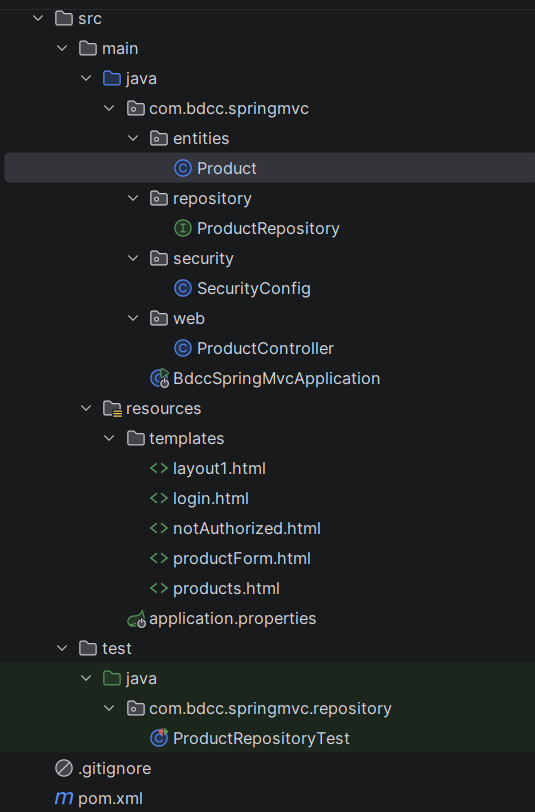

# BDCC Spring MVC — Gestion de produits

Application web JEE de gestion de produits, avec **rendu HTML côté serveur** (Thymeleaf) et **authentification stateful** (sessions + cookie `JSESSIONID`) sécurisée par Spring Security.

## Technologies

| Couche | Technologie |
|---|---|
| Framework | Spring Boot 3.3, Java 21, Maven |
| Persistance | Spring Data JPA, Hibernate, H2 (par défaut) / MySQL |
| Web / Vues | Spring MVC, Thymeleaf, Thymeleaf Layout Dialect, Bootstrap 5 (WebJars) |
| Validation | Spring Validation (Jakarta Bean Validation) |
| Sécurité | Spring Security 6, BCrypt, CSRF, `thymeleaf-extras-springsecurity6` |
| Divers | Lombok, JUnit 5 |

## Prérequis

- **JDK 21** (`java -version` doit afficher 21)
- **Maven 3.9+** (`mvn -version`) — ou simplement **IntelliJ IDEA / VS Code / Eclipse**, qui l'intègrent
- (Optionnel) **MySQL 8** si vous ne voulez pas utiliser H2

## Lancer l'application

### Option 1 — Ligne de commande
```bash
cd bdcc-spring-mvc
mvn spring-boot:run
```

### Option 2 — Fichier JAR
```bash
mvn clean package
java -jar target/bdcc-spring-mvc-0.0.1-SNAPSHOT.jar
```

### Option 3 — IDE (IntelliJ IDEA)
1. `File > Open` et choisir le dossier du projet (le `pom.xml` est détecté).
2. Attendre la fin du téléchargement des dépendances Maven.
3. Installer le plugin **Lombok** si besoin et activer `Settings > Build > Compiler > Annotation Processors > Enable annotation processing`.
4. Exécuter la classe `BdccSpringMvcApplication` (bouton ▶).


L'application démarre sur **http://localhost:8084** (port modifiable via `server.port`).

## Comptes de test

Mot de passe pour tous les comptes : `1234`

| Utilisateur | Rôles | Droits |
|---|---|---|
| `user1`, `user2` | USER | Consulter et rechercher les produits |
| `admin` | USER, ADMIN | Tout : ajouter, modifier, supprimer |



## Fonctionnalités

- Liste des produits avec **pagination** (5 par page)
- **Recherche** par mot-clé (insensible à la casse)
- **Ajout** d'un produit avec validation du formulaire
- **Édition / mise à jour** d'un produit
- **Suppression** avec confirmation (requête POST)
- Alerte **« Stock faible »** quand la quantité est inférieure à 5
- Page template commune (barre de navigation, messages, footer) via Thymeleaf Layout
- Formulaire de connexion personnalisé, affichage de l'utilisateur connecté, logout
- Page « non autorisé » à la place de l'erreur 403 brute
- Boutons masqués selon le rôle



## Règles de validation

| Champ | Contrainte |
|---|---|
| `name` | Obligatoire, entre 3 et 50 caractères |
| `price` | Supérieur ou égal à 0 |
| `quantity` | Supérieure ou égale à 1 |

## Sécurité

| URL | Accès |
|---|---|
| `/login`, `/webjars/**` | Public |
| `/user/**` | Rôle `USER` |
| `/admin/**` | Rôle `ADMIN` |
| `/h2-console/**` | Rôle `ADMIN` (développement uniquement) |
| Toute autre URL | Utilisateur authentifié |

Points importants (vus en cours) :

- Les mots de passe sont **hachés avec BCrypt**, jamais stockés en clair.
- Les opérations qui modifient les données (ajout, édition, suppression) utilisent **POST**, jamais GET.
- La protection **CSRF est activée** : Thymeleaf (`th:action`) ajoute un champ caché `_csrf` dans chaque formulaire. Pour le constater : clic droit > *Afficher le code source* sur le formulaire d'ajout.
- Deux techniques de protection sont présentes : les règles d'URL (`authorizeHttpRequests`) et les annotations `@PreAuthorize`.
- Les utilisateurs sont stockés **en mémoire** (`InMemoryUserDetailsManager`). Une évolution possible : `UserDetailsService` + base de données.

## Base de données

### H2 (par défaut)
Base en mémoire, recréée à chaque démarrage, avec 7 produits de démonstration.
Console : http://localhost:8084/h2-console (connexion en `admin`)

- JDBC URL : `jdbc:h2:mem:products-db`
- User : `sa` — Password : *(vide)*



### MySQL
1. Dans `src/main/resources/application.properties`, commenter le bloc H2 et décommenter le bloc MySQL.
2. Adapter `username` et `password`.
3. Relancer : la base `products-db` est créée automatiquement (`createDatabaseIfNotExist=true`).


`ProductRepositoryTest` teste la couche DAO (recherche, suppression, liste) avec une base H2 en mémoire.

## Désactiver Spring Security (étape 5 du TP)

Dans `BdccSpringMvcApplication`, remplacer `@SpringBootApplication` par :

```java
@SpringBootApplication(exclude = SecurityAutoConfiguration.class)
```
Puis supprimer cette exclusion pour réactiver la sécurité. Avec cette exclusion, `SecurityConfig` ne doit pas être utilisée (commenter `@Configuration`).

## Structure du projet



## Routes principales

| Méthode | URL | Rôle | Description |
|---|---|---|---|
| GET | `/` | — | Redirige vers `/user/index` |
| GET | `/user/index?keyword=&page=` | USER | Liste, recherche, pagination |
| GET | `/admin/newProduct` | ADMIN | Formulaire d'ajout |
| GET | `/admin/editProduct?id=` | ADMIN | Formulaire d'édition |
| POST | `/admin/saveProduct` | ADMIN | Enregistre (ajout ou mise à jour) |
| POST | `/admin/delete` | ADMIN | Supprime un produit |
| GET | `/login` | — | Formulaire de connexion |
| POST | `/logout` | connecté | Déconnexion |

## Problèmes courants

| Problème | Solution |
|---|---|
| `Port 8084 was already in use` | Changer `server.port` dans `application.properties` |
| Erreurs Lombok (`builder()`, getters introuvables) | Activer l'annotation processing dans l'IDE + plugin Lombok |
| `invalid target release: 21` | Installer un JDK 21 et le sélectionner comme SDK du projet |
| Bootstrap ne s'affiche pas | Vider le cache navigateur (Ctrl+F5) ; vérifier `/webjars/**` en `permitAll` |
| Erreur 403 sur un formulaire | Le jeton CSRF manque : utiliser `th:action` au lieu de `action` |
| Modification des templates non visible | `spring.thymeleaf.cache=false` est déjà actif ; actualiser avec Ctrl+F5 |
